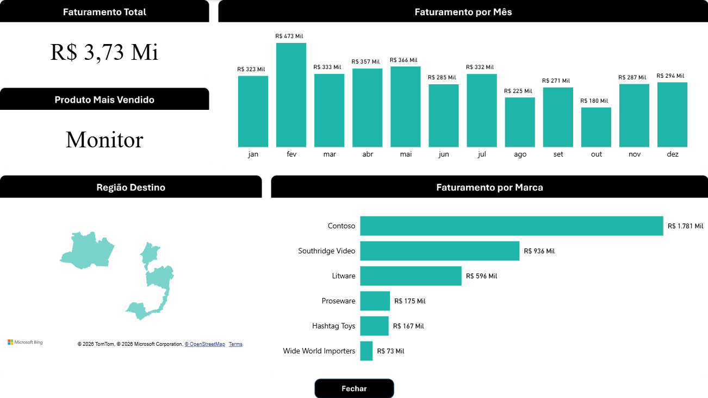

# Análise de Vendas 2020 – Power BI

Relatório de análise de vendas desenvolvido no Power BI. Os dados não vêm de banco de dados: são uma planilha com 9.685 registros de vendas de 2020, o que exigiu validação e tratamento antes da análise.



## Principais resultados

| Indicador | Resultado |
|---|---|
| Faturamento total | R$ 3.727.352,53 |
| Vendas / unidades | 9.472 vendas / 19.156 unidades |
| Produto mais vendido | Monitor (2.694 unidades) |
| Marca líder | Contoso (47,8% do faturamento) |
| Estado líder | São Paulo (50,5% do faturamento) |
| Melhor e pior mês | Fevereiro (R$ 473 mil) e outubro (R$ 180 mil) |

## Etapas do trabalho

1. **Validação da base:** campos vazios, datas, valores negativos e a regra Faturamento = Preço × Quantidade em todas as linhas.
2. **Tratamento no Power Query:** remoção de 213 linhas duplicadas, que inflavam o faturamento em R$ 146,7 mil (3,8%), e padronização de texto na coluna Marca.
3. **Modelagem:** tabela `Calendario` própria, marcada como tabela de datas e relacionada às vendas, e tabela `Medidas` dedicada às medidas.
4. **Medidas DAX:** apenas as que o relatório usa.
5. **Visualização:** capa com navegação e página de análise com plano de fundo próprio.
6. **Documentação:** [Documentacao_Relatorio_Vendas_2020.pdf](Documentacao_Relatorio_Vendas_2020.pdf).

## Modelo de dados

| Tabela | Tipo | Papel |
|---|---|---|
| `vendas` | Power Query (Excel) | Uma linha por venda. Colunas calculadas `Estado` e `País` para o mapa |
| `Calendario` | DAX | Datas de 2020, relacionada a `vendas[Data da Venda]` |
| `Medidas` | DAX | Guarda as medidas do relatório |

## Medidas

```dax
Faturamento Total = SUM ( vendas[Faturamento] )

Quantidade Vendida = SUM ( vendas[Qtd. Vendida] )

Produto Mais Vendido =
VAR _top =
    TOPN ( 1, VALUES ( vendas[Produto] ), [Quantidade Vendida], DESC )
RETURN
    CONCATENATEX ( _top, vendas[Produto], ", " )
```

## Páginas

| Página | Conteúdo |
|---|---|
| Relatório (capa) | Plano de fundo com o botão **Entrar**, que leva para a análise |
| Análise | Cartões Faturamento Total e Produto Mais Vendido, Faturamento por Mês, mapa Região Destino, Faturamento por Marca e botão **Fechar** |


## Estrutura do repositório

```
sales_performance.pbip              arquivo para abrir no Power BI Desktop
sales_performance.Report/           páginas, visuais e imagens de fundo (PBIR)
sales_performance.SemanticModel/    tabelas, medidas e Power Query (TMDL)
relatorio.png / analise2.png        planos de fundo da capa e da análise
background.pptx                     arquivo de criação dos planos de fundo
Documentacao_Relatorio_Vendas_2020.pdf
Documento_Vendas_3_medidas_uso.docx documentação editável
```

## Como abrir

1. Abra `sales_performance.pbip` no **Power BI Desktop** (versão com suporte a projetos PBIP).
2. A base `vendas.xlsx` **não está incluída**: é material de exercício de um especialista em Power BI e não é redistribuída aqui. Ela tem uma aba `Planilha1` com as colunas: Data da Venda, Produto, Preco Unitario, Qtd. Vendida, Faturamento, Marca, Cliente e Região Destino.
3. Com a sua cópia da planilha, ajuste o caminho em **Transformar dados → vendas → etapa Origem** e clique em **Atualizar**.
4. O mapa precisa da opção **Arquivo → Opções → Segurança → Usar visuais de Mapa e Mapa Coroplético** ligada.

## Ferramentas

Power BI Desktop · Power Query (M) · DAX · formato de projeto PBIP (PBIR + TMDL)
